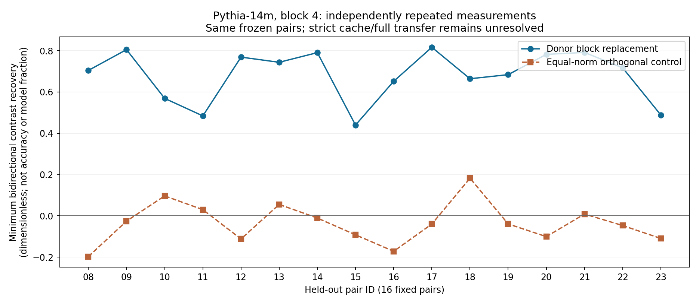

# Pythia-14m: independently verified full-prefill transfer and bounded investigation

**Independently verified full-prefill transfer and bounded investigation.** The original independent reconstruction matches the native model on the scientific full-prefill inputs, and actual independent repetition supports the bounded block-output effect. **Strict cached/full transfer remains FAILED; full strict transfer is not complete.** This report describes the verified narrower scope. The final assembled delivery package is subject to its separate whole-delivery audit.

The target is **EleutherAI/pythia-14m**, revision `cf967c0a9a04383db6f7b1108d86b2962634b4ac`, **14,067,712 parameters**, Apache-2.0. Checkpoint SHA256 is `116a02532db461f91386a5b20f942ff2c8d4de7341e21b55caafc3d7b25f49a1`. Reconstruction is explicitly **source-assisted**. This is a second architecture-specific investigation, not blind recovery or a tool that understands arbitrary checkpoints automatically.

## From weights to computation

The [computation map](transfer-002-computation-map.md) accounts for76stored tensors. The executed static atlas reports all76tensor statistics, zero nonfinite values and eight bounded singular-value analyses. Its saved outputs also include representative embedding/QK/OV-derived views. These tell us about the numerical structure of weights, not which internal features a particular sentence uses or what causes its next word. Saved atlas (`EXTERNAL_ARTIFACT_ROOT/workspaces/model-transfer-002-pythia-14m/phase/outputs/static-producer-v3/atlas.json`; external or omitted historical artifact).

For example, each token starts as a128-dimensional embedding. Across six blocks, four attention heads mix information while a GELU MLP transforms the residual representation; GPT-NeoX adds attention and MLP contributions in parallel. LayerNorm and the final output matrix turn the resulting representation into50304next-token scores. The partial rotary operation acts on8of each head's32dimensions. These details differ materially from MiniMind's mapped RMS-normalized, gated-MLP computation, so the adapter is new architecture work rather than renamed MiniMind code.

The [editable candidate](../src/minimind_re/transfer/gpt_neox_candidate.py) composes tensor operations independently of Transformers forward methods. The [native reference](../src/minimind_re/transfer/reference.py) separately operates the pinned source implementation. All50304input/output rows are retained, including27rows without tokenizer vocabulary entries; unknown decoding is shown as a numeric ID.

## What the numerical evidence says

The original measured matrix produced **5832/5832 cross-actor comparison rows passing with maximum absolute error0.0**, covering nine boundaries in its specified modes. This means the independent computation matched the native reference when both followed the same execution path. It is valuable reconstruction evidence, but it does not erase a different failed question: cached continuation versus recomputing the full prefix. Complete original comparison receipt (`EXTERNAL_ARTIFACT_ROOT/workspaces/model-transfer-002-pythia-14m/phase/outputs/numerical-producer-v3/comparison.json`; external or omitted historical artifact).

The full original matrix remains **strict T2 FAIL**. The native implementation itself failed the strict cached/full comparator. Arithmetic diagnostics isolated shape-sensitive affine behavior; attempted canonical changes improved cache consistency in a small pilot but failed required native-output fidelity. Crossed readout tests also rejected a readout-only fix. [Independent crossed readout review](../evidence/transfer-002/review/readout-probe-v1-results.json). Those failed candidates, raw arrays and charges remain preserved and **not promoted**. No cached deployment, universal backend equivalence or repaired strict T2 is claimed.

The active scope follows the user's earlier direction to retain the cache discrepancy and investigate within a supported full-prefill mode. It introduces **T2S**, a separately named scientific-input fidelity gate, while preserving original T2FAILED. [Exact scope amendment](../evidence/transfer-002/amendments/full-prefill-slice-v1/manifest-v1.json).

## The controlled question being tested

The experiment asks: if we replace one block's final-position representation with the representation from a matched alternative sentence, does the next-token distribution move toward that donor sentence more than it does under an equal-size orthogonal edit?

This edits a **whole128-dimensional block output**, not a single attention head or an identified circuit. It tests a bounded directional effect at a representation boundary. Scientific interventions run through native PyTorch hooks. Candidate/native baseline agreement is checked separately; this study does not establish equivalence of their intervention implementations.

Eight development pairs select among blocks0–4. Sixteen held-out pairs evaluate the frozen choice. Prompt pairs differ in a noun, with disjoint names between development and heldout; they retain the same noun families, so this is a narrow context holdout rather than broad semantic generalization. It requires no reliable chat or question-answering performance. A predetermined full-vocabulary contrast defines the output measurement, and weak baseline contrasts remain in denominators with explicit eligibility labels.

Each held-out pair has baseline, target edit, equal-norm orthogonal control, self-copy no-op and restored calls in both directions. Parameter/artifact identities must remain unchanged. No-op/restoration checks separate an actual edit effect from accidental hook or state damage. The frozen rules can return supported, refuted or inconclusive; all-ineligible observations cannot establish a donor-mediated mechanism. [Scientific protocol](../specs/002-model-transfer/internal-protocol-proposal.md).

## Independently repeated controlled result

Development selected **block4 (zero-based, the fifth of six blocks)**. On the fixed16held-out pairs, all16were eligible and all16showed positive effects in both directions. Median minimum bidirectional target recovery was **0.710486**; median paired target-minus-control advantage was **0.773133**. All four preregistered support thresholds passed, giving `SUPPORTED_BOUNDED_BLOCK_EFFECT`, independently recomputed and reproduced.

Recovery measures movement in a fixed pair-specific logit contrast toward the donor. For each pair we retain the smaller of the two directional recoveries. A value1 would mean closing that chosen baseline contrast gap in both directions; values can be negative or exceed1. **0.710486 does not mean71%accuracy,71%of the model explained, or a recovered circuit.** The paired advantage is computed within each pair before taking its median; it is not necessarily the difference between two separate medians.

Every plotted point comes from the saved producer `heldout_rows`; no data were simulated. The control has equal edit norm and approximately orthogonal direction at the same block. Larger target alignment therefore supports a specific directional effect beyond edit size on these pairs, while the study remains a coarse whole-block intervention and cannot establish unique necessity or head-level mediation.

| Required result | Independently verified scope |
|---|---|
| T2S baseline fidelity | **432/432** checks passed:48members ×9boundaries, full50304vocabulary |
| Selected layer | **4**, frozen development selection |
| Held-out result | **16/16eligible,16/16positive bidirectional; independently SUPPORTED** |
| No-op/restoration and native parameter preservation | Raw no-op/restored arrays exact; parameter before/after digests identical |
| Original artifacts | Original artifact identities independently rechecked; unchanged |
| Independent actual repeat | **PASS**, actual389-call repetition and raw audit |
| Actual-input trace | All9trace boundaries independently checked; walkthrough below |
| Scientific/static verification | **PASS**; separate assembled delivery audit follows |
| Original strict cached/full T2 | **FAIL**, unchanged |

Producer executed389calls and12448positions without cache reuse. Summary (`EXTERNAL_ARTIFACT_ROOT/workspaces/model-transfer-002-pythia-14m/phase/outputs/science-full-producer-v2/summary.json`; external or omitted historical artifact) SHA256 `cf6506d43585c39820fbe66c3fef5d74ec31753de222c3fe8bc8edb3f230bffc`; selection (`EXTERNAL_ARTIFACT_ROOT/workspaces/model-transfer-002-pythia-14m/phase/outputs/science-full-producer-v2/selection.json`; external or omitted historical artifact) SHA256 `185b9d08a2ee6a5e9dceeacb4477a0fd8f3b4181570b1ba6013d3d5e3582b70b`. Coordinator supplied terminal identity `2a1e5ab84f71cf9b736c7f51863591406bd2fd73c8873758118147e025b0713a`; the independent result below separately establishes actual repetition.

The [independent scientific receipt](../evidence/transfer-002/review/science-full-independent-v2-results.json), SHA256 `9fce319281f99807ab0b880a555b10c66a63dd432c8329fb4206a3f1aa912392`, verifies **1531output files byte-for-byte**, including **1271finite FP32arrays /712620544payload bytes**. It independently recomputed all56metric rows and edit deltas, selection, matched controls and heldout verdict; checked432baseline comparisons, exact no-op/restoration, all9trace boundaries and unchanged artifacts/native parameter digests. Independent execution was389calls/12448positions,257.6245953049511supervisor seconds, peak sampled group RSS1046962176bytes. This repeats identical frozen fixtures; it does not add an out-of-distribution population.

The [independent static receipt](../evidence/transfer-002/review/static-independent-v4-results.json), SHA256 `82d46dbfd4366849a9d5f736df076d704d901866ec4eec03cd149f119958ed38`, verifies exact atlas repetition including all76tensor statistics,48raw views and eight spectral analyses. This is static structure, distinct from intervention evidence.

**Protocol provenance overlay:** the immutable summary records original scientific-body SHA256 `ab8eac0f5a5ad71afbb2f37e1320ab7d7e38bcd9965e7f5fac95e2d236d6452f`. Its executed packet separately binds the amended scientific document SHA256 `bbab2d7e97f36ba56ecf364905e66ee7df43dd53d7ab08510c3a09df8375e454`, the full-prefill scope and exact sources. The original341-call scientific schedule plus48candidate baselines explains389calls. Treat these as original protocol provenance plus reviewed scope/parity overlay; the old summary field alone does not identify the entire executed contract. Executed outputs have not been edited to hide the difference.

## Follow one actual input

The saved input is **“In the story, Anna found a cat. Later, Anna picked up the”**. Its15real token IDs are `[688, 253, 2926, 13, 16543, 1119, 247, 5798, 15, 14772, 13, 16543, 5055, 598, 253]`. Decoded pieces (spaces retained in the saved record) are: `In |  the |  story | , |  Anna |  found |  a |  cat | . |  Later | , |  Anna |  picked |  up |  the`. Seventeen masked ID0positions pad the input to32physical slots; real logical positions run0–14. The final real token is “ the” at physical31. This is a measured prompt, not a generated illustrative example.

The saved native and candidate arrays have these nine boundary dimensions: embedding `[1,32,128]`; each block0–5 `[1,32,128]`; final normalization `[1,32,128]`; logits `[1,32,50304]`. These are computation snapshots. The last-token block norms and step-to-step change norms below are derived from saved vectors; they do not themselves measure semantic importance.

| Block index | Last-token L2 norm | Change from previous representation, L2 |
|---|---:|---:|
| 0 | 1.004142 | 0.990297 |
| 1 | 0.825527 | 0.656069 |
| 2 | 1.118224 | 0.940167 |
| 3 | 1.335792 | 1.052023 |
| 4 | 1.514787 | 1.208456 |
| 5 | 2.147039 | 2.014132 |

After final normalization and the output projection, the largest saved next-token logit is **11.532724380493164 at ID5798**, which the input trace decodes as “ cat”. The next two are ID4370 at9.862682342529297 and ID806 at9.854143142700195. These are raw logits, not probabilities, and only the first token's decoding is established from this saved input mapping here. No multi-token generation or general language competence follows from this single next-token preference.

Saved trace input and vector summaries (`EXTERNAL_ARTIFACT_ROOT/workspaces/model-transfer-002-pythia-14m/phase/outputs/science-full-producer-v2/trace-input.json`; external or omitted historical artifact) links text, IDs, masks, positions, all six last-position vectors and top10scores. Block4's intervention replaces a128-dimensional representation before block5 and final output computation. That location explains where the causal edit enters; it does not isolate a particular head or source-token edge. The trace omits attention probabilities, QK edges and MLP intermediate captures. No new Manim video was requested or produced.

## Using and extending the delivered pieces

Use [the usage guide](model-transfer-usage.md) for model-free evidence inspection, actual guarded CLI/API interfaces and fresh-run requirements. Read the map and atlas now; use the original candidate only within the exact admitted full-prefill scientific scope. Do not treat unresolved cached execution as an accepted production path. New runs need fresh IDs, resource reconciliation and exact independent admission; never rerun a consumed packet or overwrite failed evidence.

The established scoped result is **independently verified full-prefill process transfer plus bounded controlled investigation, with strict cache/full transfer unresolved**. MiniMind's separate accepted mode and bounded mechanism remain their own evidence. Two architecture-specific outcomes do not establish universal model dissection, complete semantic understanding or equivalent behavior under arbitrary interventions.
