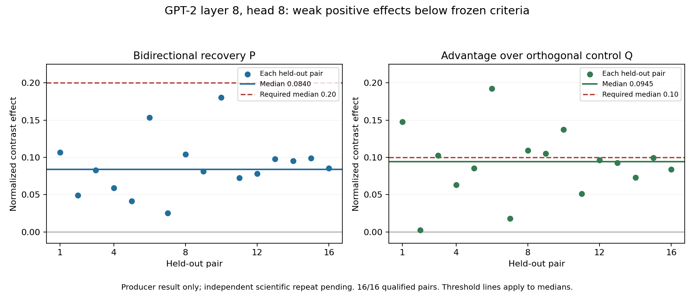
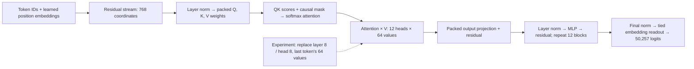

# GPT-2 dissection result — candidate for final review

**DRAFT: numerical reconstruction and atlas independently accepted; scientific producer completed with qualified REFUTED result. Independent scientific repetition/audit and final delivery review remain pending. GPT-2 is not yet recorded as the third completed application.**

We have an editable, source-assisted GPT-2 reconstruction that matched the native implementation exactly on the frozen numerical matrix, a repeated weight atlas, and a completed producer experiment that changed the same internal head in both native and candidate. The producer found weak positive effects below the criteria specified before held-out testing. This is a useful bounded result; it does not establish whole-model understanding or automatic recovery of arbitrary models.

## The scientific finding

Development selected **layer 8, head 8** (zero-based indices) from12predefined sites using eight development prompt pairs. All12development sites and all16held-out pairs qualified; no calls were skipped. The producer completed1,186calls and9,488physical token positions.

| Preregistered requirement | Producer measurement | Outcome |
|---|---:|---|
| Median bidirectional normalized recovery P ≥0.20 |0.08404521678273584 | Below criterion |
| Median advantage over orthogonal control Q ≥0.10 |0.09451938285766666 | Below criterion |
| At least12/16 pairs with Q>0 |16/16 | Pass |
| All16held-out pairs eligible |16/16 | Pass |

The preregistered verdict is therefore **REFUTED** for the claim that this selected head meets all specified effect-size criteria on this corpus. Positive direction in16pairs does not override the failed median thresholds. No threshold was changed, no held-out site was substituted, and no claim that the head is useless follows. A small effect, redundancy, other tasks or another site are not ruled out. A qualified negative finding can complete the scientific task once independently verified.

Each point is one held-out pair, averaging clean→corrupt and corrupt→clean directions. Threshold lines apply to medians, not individual points. P measures the fraction of a baseline-derived logit contrast transferred by the head replacement; Q subtracts the norm-matched orthogonal-control recovery. The contrast is selected deterministically from native baseline logits; it is not a correct-answer score. Full vocabulary logits at the final real position were retained.

Producer descriptive paired-bootstrap95% intervals: median P[0.07034081888094251,0.09900662063046933], median Q[0.07314895278785793,0.10513940342360756]. They use10,000whole-pair resamples, seed20261119, and do not override the frozen verdict. Secondary donor-directed KL/raw-gap metrics are saved; favorable secondary measures do not rescue the primary hypothesis.

Source: producer result (`../evidence/transfer-003/runtime/additive-v2/science-producer-result.json`; external or omitted historical artifact), SHA256`029cefca9fc219e32159355e5ed131c968a2c90792c5e8ffd84df95108d13909`; [report metric snapshot](../evidence/transfer-003/delivery/producer-report-metrics-v1.json). Producer summary SHA256`795a463a4c943612fd20c699be255e018b33e26bc7ec9f77886c821566349172`. This section awaits independent actual scientific repetition and audit.

## What changed inside the model

The actual trace input was `The code is red. The code is` (eight tokens). The matching corrupt development prompt substitutes `blue` for `red`. Exact saved trace receipts show embedding/block/final-normalization tensors of shape[1,8,768], full logits[1,8,50257] and head outputs[1,8,12,64]. These are actual producer captures, with independent scientific trace validation pending. The computation map (`gpt2-computation-map.md`; external or omitted historical artifact) supplies exhaustive weight names and source-assisted equations; its earlier build-only status is historical context, superseded by separate runtime receipts where applicable.

At the attention output-projection input, the experiment replaces only the selected head's64values at the final real token with that actor's donor-prompt vector. The surrounding heads/positions must remain byte-identical. The normal packed output projection and downstream blocks then carry the changed vector to the readout; their parameters are not rewritten. The reverse direction swaps the donor/recipient roles.

A norm-matched orthogonal change in the same64-dimensional space checks whether the effect depends on the donor direction rather than merely perturbation size. No-op and restored executions check reversibility. Native and independently composed candidate both perform the actual interventions, not merely baseline comparison. Producer receipts report preservation and validity checks passing; independent audit must establish hook layout, complement invariance, edited-result parity, controls and trace before scientific acceptance.

## Established numerical and static evidence

Independent full numerical review (`../evidence/transfer-003/review/full-review-v2.json`; external or omitted historical artifact), SHA256`fa9c83e11fd60e2b94c5350f464c05c0337c5cda9ccc697d0edc83e65d874d62`, accepted16fixtures with real lengths1/8/32/64, unpadded/right-four padding,15boundaries and complete50,257logit vocabulary. Each role executed96calls/2,712physical positions and1,680comparisons. Maximum absolute error was0; all1,440raw arrays were byte-identical between producer and actual independent repeat,661,825,632bytes per role. No-op/restoration and live tensor preservation passed. This covers the frozen mode/fixtures, not arbitrary-length/input, cache or left-padding behavior.

Independent atlas review (`../evidence/transfer-003/review/atlas-actual-v2.json`; external or omitted historical artifact), SHA256`67a97c9740b7d1ca29f1275029d21565ba1e20b1eac900f5c38dbbd3bf99cafc`, accepted24repeated QK/OV matrices totaling56,623,104byte-identical bytes;160stored tensors,148learned tensors/124,439,808parameters,12causal buffers,144head norm entries and12selected sites. Reviewed source orientation plus exact actual repeat was used; an alternative independent weight-arithmetic engine was not claimed. Static QK/OV omit normalization, biases, positions, softmax and context and therefore do not establish semantics or causality.

The population-std supplement (`../evidence/transfer-003/static-supplement/producer-population-std-v1.json`; external or omitted historical artifact), SHA256`e5871963bff86d21c31a8695ae84796d227a0a10b5f46aaebe155176937bace5`, covers160rows and was independently recomputed from saved rounded mean/RMS. It is **derived population standard deviation, not direct centered weight reduction**; upstream reduction/cancellation caveats remain.

## Identity, resources and reproducible use

Target: `openai-community/gpt2@607a30d783dfa663caf39e06633721c8d4cfcd7e`; checkpoint SHA256`248dfc3911869ec493c76e65bf2fcf7f615828b0254c12b473182f0f81d3a707`. Acquisition audit (`../evidence/transfer-003/review/acquisition-v1.json`; external or omitted historical artifact) verified the550,967,953-byte eight-file bundle. Stored buffers and tied output are accounted separately from learned parameters. CPU FP32 eager, two threads, unpadded/right-padded full-prefill with first key visible is the supported mode; scientific pairs here were all unpadded/eight tokens. Saved token IDs were independently decoded to text, not independently re-encoded.

Producer science supervisor elapsed517.4306551560294seconds, peak sampled group RSS2,284,425,216bytes, added disk313,519,939bytes; actual packet output313,063,988bytes. Sampled RSS is not a continuous exact peak. These measurements do not isolate guard overhead or prove general speed improvements. Existing failure records and unrelated workloads remain preserved.

To inspect the result, start with this report and its chart, then the tensor/computation map (`gpt2-computation-map.md`; external or omitted historical artifact), frozen scientific protocol (`../specs/003-model-dissection/internal-protocol-v1.md`; external or omitted historical artifact), exact receipts and saved metric inputs. The chart script (`figures/gpt2-plot-producer-v1.py`; external or omitted historical artifact) regenerates only PNG/SVG from saved metrics with no model imports/calls; [chart provenance](../evidence/transfer-003/delivery/producer-chart-v1.json) binds script/input/output hashes. Numerical/raw science lives in `EXTERNAL_ARTIFACT_ROOT/workspaces/model-transfer-003-gpt2`; exact paths are in the receipts. Do not treat saved admission files as standing authorization to rerun against a changed or exhausted phase. A new runtime attempt requires identity, readiness and remaining-budget reconciliation through the reviewed workflow.

## Tool choices, sources and remaining acceptance

Native PyTorch/Transformers provided the reference and minimal hooks; the candidate preserves GPT-2 learned positions, Conv1D orientation, packed arithmetic and tied readout. The selection research (`../evidence/transfer-003/research/model-selection-v1.md`; external or omitted historical artifact) and methods research (`../evidence/transfer-003/research/methods-v1.md`; external or omitted historical artifact) explain the choice. TransformerLens/NNsight/pyvene informed method/API design; no installed or validated integration with those packages is claimed.

Primary references: [GPT-2 paper](https://cdn.openai.com/better-language-models/language_models_are_unsupervised_multitask_learners.pdf), [OpenAI GPT-2 source](https://github.com/openai/gpt-2), [TransformerLens patching implementation](https://github.com/TransformerLensOrg/TransformerLens/blob/284e35b4ee2deea0924894c221a3be8ad519474d/transformer_lens/patching.py), [activation-patching methodological choices](https://arxiv.org/html/2309.16042v2), and [interpreting activation patching](https://arxiv.org/html/2404.15255v1). These motivate design and limitations; the local exact receipts establish this run's behavior.

Pending: independent actual scientific repetition, independent raw/control/trace/metric audit, then final exact report/manifest review and controller acceptance. No more hypothesis search is required merely because the preregistered effect-size claim was refuted. Stop after the third scoped application meets its evidence requirements.
